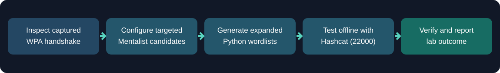
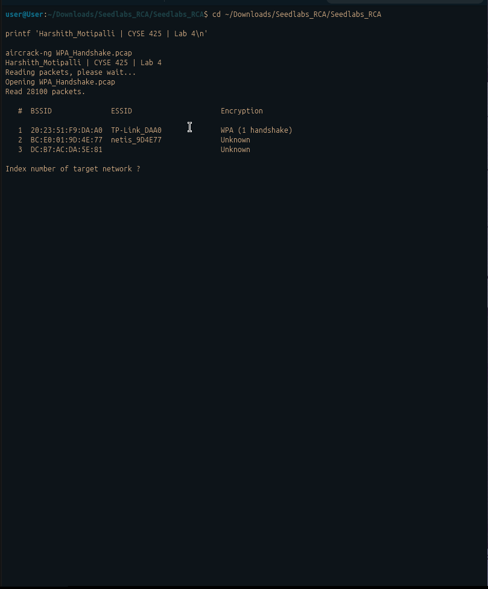
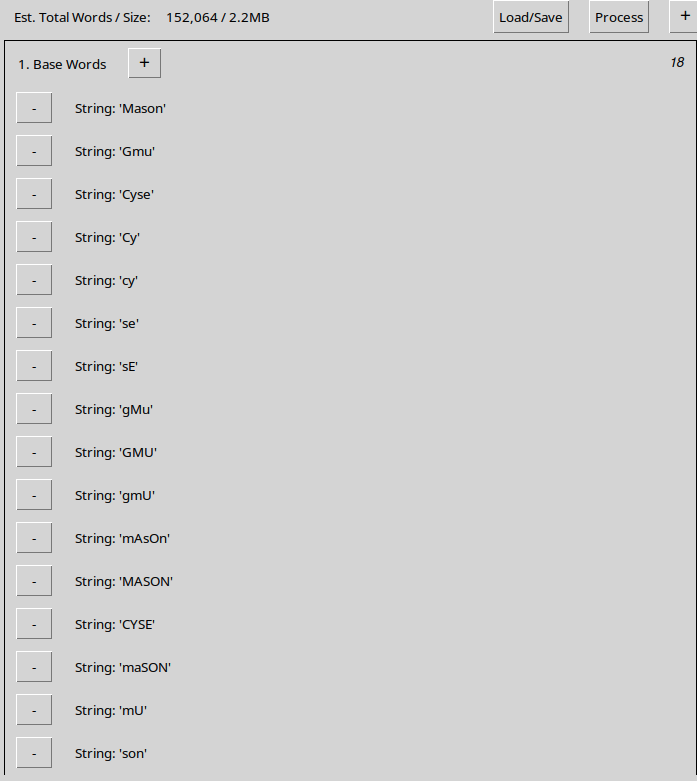
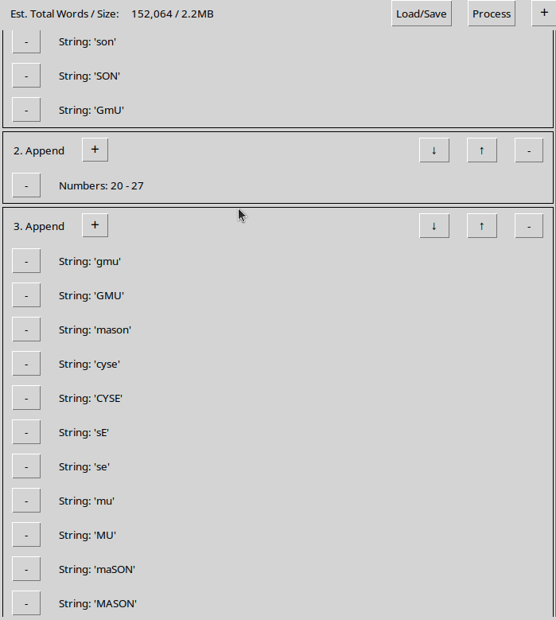
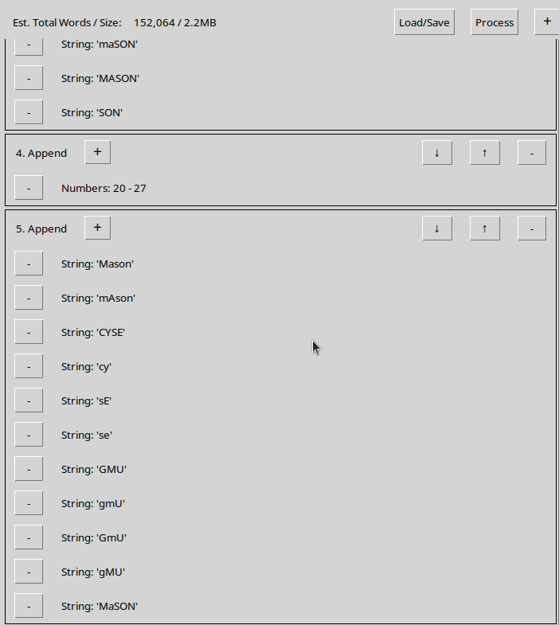
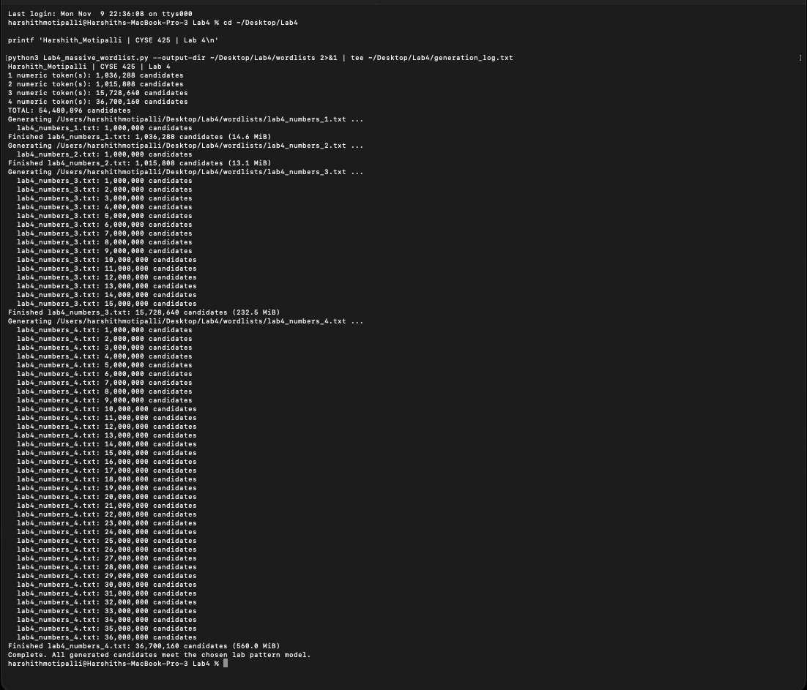
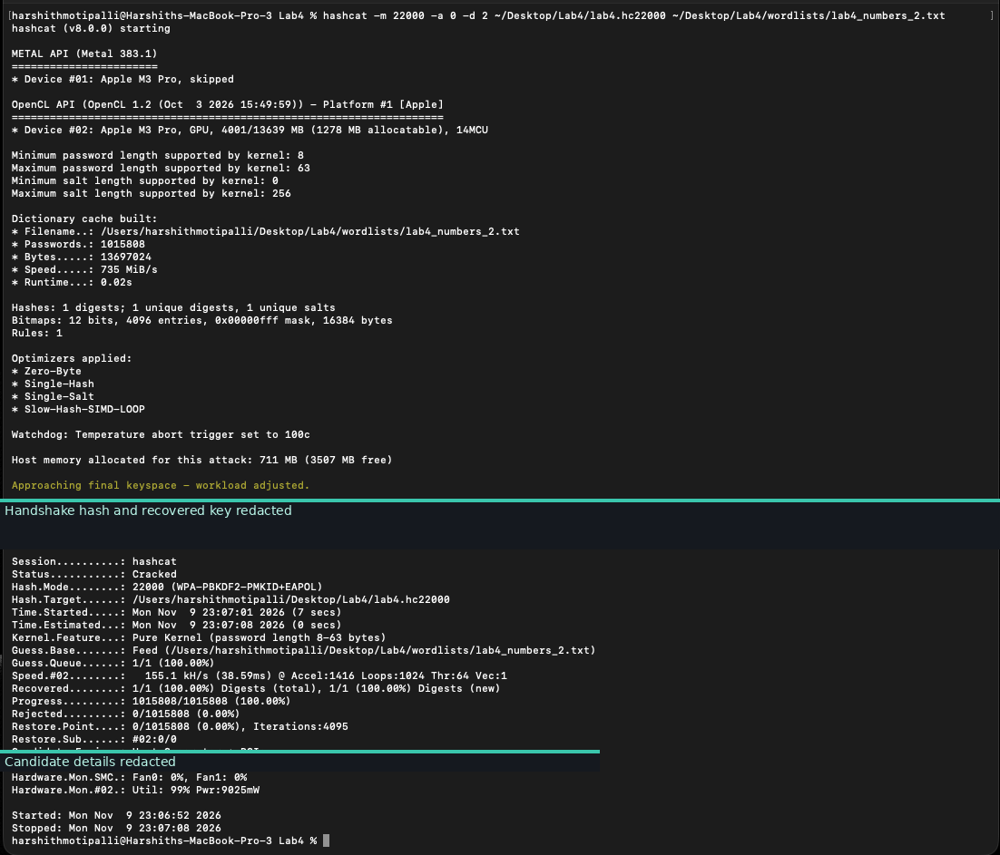
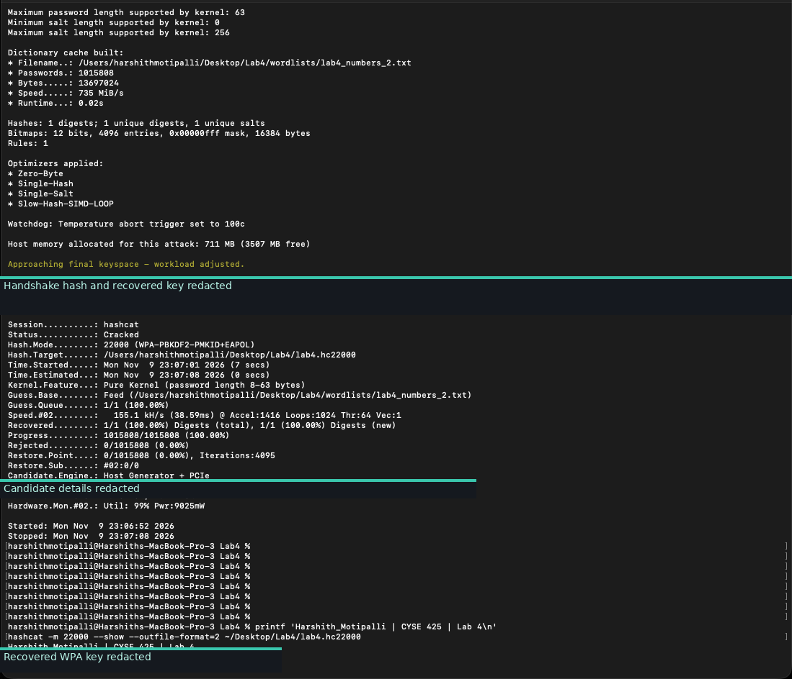

# CYSE 425 — Lab 4: WPA Handshake and Password Security Assessment

  

Analyzed a captured **WPA four-way handshake** and evaluated the strength of a lab wireless pre-shared key through **targeted wordlist generation and offline password testing**. The assessment used Aircrack-ng for handshake verification, Mentalist and Python to build candidate lists, and Hashcat to validate whether a candidate matched the captured authentication data.

**Lab report:** [View the redacted eight-page PDF](docs/CYSE425_Lab4_Report_Redacted.pdf)

## At a glance

| Item | Details |
|---|---|
| Focus | WPA handshake verification and offline password-strength testing |
| Tools | Aircrack-ng, Mentalist, Python, Hashcat 8.0.0 |
| Capture analysis | 28,100 packets; one WPA handshake identified |
| Mentalist candidate estimate | 152,064 |
| Expanded Python-generated candidates | 54,480,896 across four wordlists |
| Hashcat test | Mode 22000, dictionary attack mode 0, 1,015,808 candidates |
| Recorded outcome | Password recovery confirmed; credential redacted for public viewing |

## Assessment Workflow

## Evidence Screenshots

**All seven screenshots are embedded directly below** in the order of the submitted lab report. Recovered credentials and WPA handshake hash material are masked in the public images.

### Handshake identification

**01. Aircrack-ng WPA handshake detection**

*Aircrack-ng identified one captured WPA handshake for a lab network after parsing 28,100 packets.*

### Targeted wordlist configuration

**02. Mentalist base-word configuration**

*Mentalist base-word entries included capitalization and fragment variations.*

**03. Mentalist numeric and keyword append rules**

*Append stages included number patterns and keyword fragments; estimated output was 152,064 candidates.*

**04. Additional candidate-combination rules**

*Additional append-stage variations completed the smaller Mentalist configuration.*

### Expanded candidate generation

**05. Python generation of 54,480,896 candidates**

*A custom Python generator produced four wordlist files totaling 54,480,896 candidates, according to the terminal output.*

### Offline password audit

**06. Hashcat offline cracking result**

*Hashcat v8.0.0 used mode 22000 and attack mode 0 with a 1,015,808-candidate dictionary. It reported Cracked and 155.1 kH/s.*

**07. Hashcat verification of recovered credential**

*Hashcat verification confirmed one recovered credential. The password and handshake hash are redacted from this public copy.*

## Findings and Evidence

| Finding | Evidence |
|---|---|
| Captured authentication data | Aircrack-ng recognized one WPA handshake in a 28,100-packet capture. |
| Targeted candidate patterns | Mentalist configuration estimated 152,064 combinations. |
| Scaled candidate generation | Python output listed four files totaling 54,480,896 candidates. |
| Offline verification | Hashcat v8.0.0 used mode 22000 and a 1,015,808-entry wordlist. |
| Recovery outcome | Hashcat reported Cracked with 100% of the single recorded digest recovered. |
| Execution performance | Recorded Hashcat device speed was 155.1 kH/s on the MacBook test environment. |

## What This Project Demonstrates

- Interpreted WPA handshake capture results in Aircrack-ng.
- Built targeted password candidate sets using Mentalist and Python.
- Worked with Hashcat dictionary attacks for offline WPA password-strength assessment.
- Compared wordlist size, workload, and measured cracking performance.
- Documented a successful lab result while keeping recovered credentials out of public artifacts.
